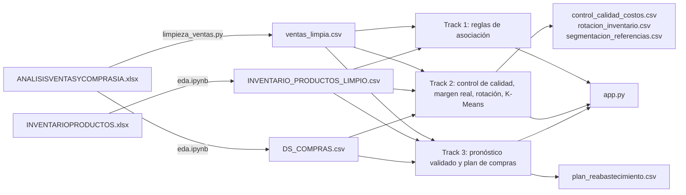

# Proyecto 2: rentabilidad, lento movimiento y reabastecimiento de autopartes

Análisis de ventas, compras e inventario de cuatro familias de autopartes
(ACEITES, BATERIAS, FILTROS y LLANTAS), con datos de enero de 2025 a julio de 2026.

**Usuarios:** jefe de compras y jefe de bodega.
**Proceso anterior:** revisión manual en tablas de Excel o en el software de
inventario, referencia por referencia.

| Track | Pregunta | Resultado principal |
|---|---|---|
| 1. Venta cruzada | ¿Qué familias se compran juntas? | Solo FILTROS ↔ ACEITES es una asociación fuerte (confianza 88 %, lift 4,5) |
| 2. Rentabilidad y lento movimiento | ¿Qué datos de costo están mal, cuál es el margen real y cuánto inventario no rota? | 99 referencias con costo o precio anómalo; 185 M COP (34 % del stock valorizado) sin venta hace más de 180 días |
| 3. Reabastecimiento | ¿Cuánto comprar de cada referencia? | Plan para 30 días validado contra 5 modelos; se elige el de menor error |

## Estructura del repositorio

```text
.
├── app.py                         # Dashboard (Tracks 1, 2 y 3)
├── src/
│   └── analitica.py               # Lógica compartida por notebooks y dashboard
├── data/
│   ├── raw/                       # Archivos fuente; no modificarlos
│   └── processed/                 # CSV de trabajo y resultados
├── notebooks/
│   ├── eda.ipynb                  # Exploración y preparación de datos
│   ├── 02_etl_y_track1.ipynb      # Track 1: reglas de asociación
│   ├── track2.ipynb               # Track 2: calidad de costos, rentabilidad, rotación y segmentación
│   └── Track3.ipynb               # Track 3: pronóstico validado y plan de compras
├── reports/
│   ├── figuras/                   # Gráficas para la presentación (PNG)
│   └── treemap_rentabilidad.html  # Árbol interactivo familia → perfil
├── scripts/
│   └── limpieza_ventas.py         # Normaliza y exporta las ventas
├── .python-version                # Python 3.11.9
└── requirements.txt               # Dependencias con versiones fijas
```

## Flujo de datos



Toda la lógica de cálculo está en `src/analitica.py`. Los notebooks y el
dashboard la importan, así que siempre producen los mismos resultados.

## Requisitos e instalación

Con Python **3.11.9**, desde la raíz del repositorio en PowerShell:

```powershell
py -3.11 -m venv .venv
.\.venv\Scripts\Activate.ps1
python -m pip install --upgrade pip
python -m pip install -r requirements.txt
```

En VS Code, selecciona el intérprete `.venv` como kernel de cada notebook.

## Cómo ejecutar

1. **EDA:** ejecuta [`notebooks/eda.ipynb`](notebooks/eda.ipynb). Genera el inventario
   limpio y el extracto de compras en `data/processed/`.
2. **Ventas:** ejecuta `python scripts/limpieza_ventas.py`. Genera `ventas_limpia.csv` con las
   columnas que usan los tracks (`codigo`, `cantidad`, `precio_unitario`, etc.).
3. **Tracks:** ejecuta los notebooks [Track 1](notebooks/02_etl_y_track1.ipynb),
   [Track 2](notebooks/track2.ipynb) y [Track 3](notebooks/Track3.ipynb). Son independientes entre sí.
   Desde la terminal también se pueden ejecutar así:

   ```powershell
   cd notebooks
   python -m jupyter nbconvert --to notebook --execute --inplace 02_etl_y_track1.ipynb track2.ipynb Track3.ipynb
   ```

4. **Dashboard:** desde la carpeta del proyecto, con el entorno virtual activado:

   ```powershell
   .\.venv\Scripts\Activate.ps1
   python -m streamlit run app.py
   ```

   Se abre en el navegador, en `http://localhost:8501`; para cerrarlo, presiona `Ctrl + C`.
   La primera vez Streamlit pide un correo: presiona Enter para omitirlo.
   En la barra lateral se pueden cargar versiones nuevas del inventario, las ventas o las compras.

## Decisiones de método

- **Track 1:** el soporte y el lift se calculan sobre **todas** las facturas (45.982), no solo
  sobre las que contienen alguna de las 4 familias. Si se usa solo ese subconjunto, el lift queda
  subestimado (1,16 en lugar de 4,5).
- **Track 2, calidad:** el costo del inventario se contrasta con el costo mediano de compra, el
  precio real de venta y el precio de lista. Un costo más de 3 veces por encima o por debajo de las
  compras se trata como probable error de digitación y, para los cálculos, se reemplaza por la mediana de compra.
- **Track 2, margen:** se usa el margen **real** (precio facturado frente al costo). En llantas y
  baterías el margen de lista es igual para todas las referencias (precio = costo × factor fijo),
  así que no sirve para comparar.
- **Track 2, segmentación:** K-Means sobre log(unidades) y margen real, sin las referencias con
  datos anómalos. k se elige por silhouette.
- **Track 3:** se usan compras reales, meses sin venta = 0, se excluye el mes incompleto
  (julio de 2026) y se hace validación con origen móvil en 3 meses. El stock de seguridad es
  1,65 × la desviación estándar de las ventas de 6 meses, y no se sugieren compras para
  referencias sin ventas en 6 meses.

## Limitaciones

- Análisis a nivel de 4 familias. No hay subcategorías oficiales en los datos.
- El margen real usa el costo actual (corregido) para todo el periodo; no hay costo histórico por venta.
- Se asume que el stock del inventario corresponde a la fecha de corte de las ventas (10-jul-2026).
- Son 18 meses de historia, insuficientes para modelar la estacionalidad anual. No se conocen los
  tiempos de entrega de los proveedores.
- Los diagnósticos de calidad y el plan de compras son **sugerencias** que deben validar el jefe
  de compras y el de bodega.
